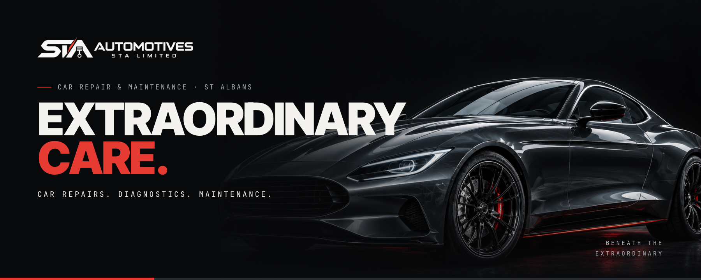
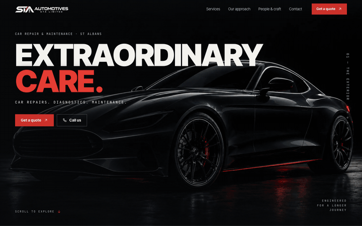
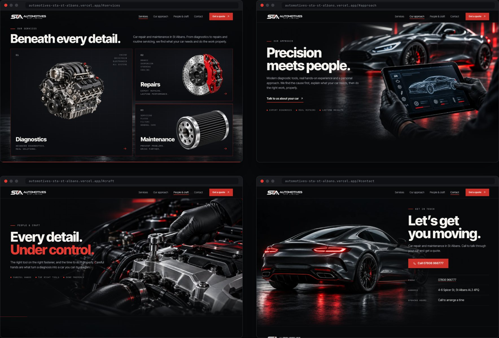
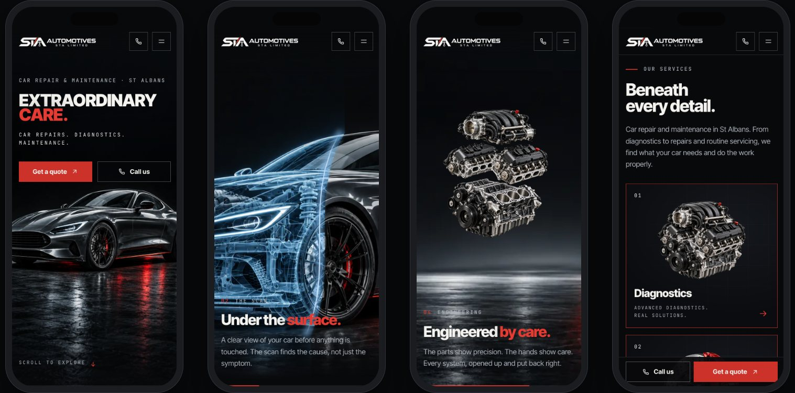

<div align="center">



<h3>A one-page website for a car repair company in St Albans, built around a scroll-driven scene that goes beneath the bodywork: a light reveals the car, a scan line turns it to wireframe, the engine opens up, and its parts land in the service cards.</h3>

<p>
  <a href="https://automotives-sta-st-albans.vercel.app"><strong>🌐 Live site</strong></a>
  &nbsp;·&nbsp;
  <a href="#hero-animation"><strong>🎬 How the hero works</strong></a>
  &nbsp;·&nbsp;
  <a href="#getting-started"><strong>🛠️ Run it locally</strong></a>
</p>

<p>
  <a href="https://automotives-sta-st-albans.vercel.app"></a>
  
  
  
  
  
</p>

</div>

<br />

## 🚀 Overview

**Automotives STA** is a car repair and maintenance company at 4-6 Spicer Street, St Albans: diagnostics, repairs and routine maintenance. The site follows the company's creative direction *Beneath the Extraordinary*: black, silver and one red, monumental type, a campaign car and an asymmetric grid. Its idea fits in three lines of the brief: **the bodywork draws you in, the engineering explains it, the care converts.**

The opening is a single scroll-driven scene. A light passes over the dark car and **reveals it**; the camera moves in on the front axle while **a cold scan line crosses the bodywork** and leaves wireframe behind it; the **engineering appears inside the silhouette**; the **engine takes over** at the same place and size, **opens into its groups** while the brake and the oil filter arrive, closes again, and then **the engine, the brake and the filter land in the Diagnostics, Repairs and Maintenance cards**.

From there the page calms down: the approach, the craft, and the contact. Every call to action goes to one of two places: **Get a quote** (the contact section) or **Call us** (`tel:+447806966777`).

- **Cinematic first impression**: a pinned 2.5D scene made of the kit's own image layers, not a video and not a frame sequence
- **Measured, not guessed**: the car states, the scan plane and the engine groups are registered with OpenCV, so every crossfade and every hand-off lands in place
- **Built for every visitor**: shorter scene on phones, no pinned section with reduced motion, full keyboard support and visible focus
- **Honest by default**: no prices, no opening hours, no ratings and no reviews until the company provides them; concept images are labelled as such

<br />

<a name="hero-animation"></a>

## 🎬 The hero animation

<div align="center">
  <a href="https://automotives-sta-st-albans.vercel.app"></a>
  <sub>Scroll-scrubbed on the live site · captured at 1440 × 900</sub>
</div>

<br />

The hero stays pinned for about five and a half extra screen heights and follows the storyboard of the brief, *Do carro ao cuidado* (from the car to the care):

| Scroll | What happens |
| :----- | :----------- |
| 0–10%  | **Reveal** (01): the dark car, *Extraordinary care.*, **Get a quote** and **Call us**; a light passes over the car from left to right and leaves it lit |
| 6–31%  | **The scan** (02): the camera moves in on the front axle while a cold scan line crosses the bodywork; behind the line the car is wireframe: *Under the surface.* |
| 29–47% | **Inside** (03): the whole body turns to lines, then the engineering appears inside the silhouette and the camera moves in on the engine under the bonnet |
| 44–56% | **Engineering** (04): the engine itself takes over at the same place and size, the car fades into the studio, and the engine moves to the centre |
| 55–77% | **Five groups**: the engine opens into intake, heads and block while the brake and the oil filter arrive, with thin red leader lines; then it closes again: *Engineered by care.* |
| 76–92% | **Services** (05): *Beneath every detail.* appears, the red frames of the three cards are drawn, and the engine, the brake and the filter land in Diagnostics, Repairs and Maintenance |
| after  | **Hand-off**: when the pin releases, the finished services section scrolls away as one piece and *Precision meets people.* follows |

**Under the hood**

- 🧩 **One smoothed scroll value drives everything.** The scene is a pure function of the scroll position (`render()` in `src/js/hero.js`), so it runs backwards as cleanly as forwards and resizes without state to rebuild.
- 📐 **Registered with OpenCV.** `scripts/register-scene.py` matches every car state (dark, lit, scan, wireframe, cutaway, cut-out) against the lit hero with SIFT and RANSAC: they all sit within about half a pixel of it, so they share one frame and crossfade in place. The three engine groups are registered on the assembled engine the same way, and the spacing of the separation comes from the kit's exploded master (the measurements agree with the kit's own `registro-motor.json` to within a few pixels).
- 🔵 **The scan line follows the real plane.** The scan plane in the kit's image is curved, not straight. The script traces it row by row, where `carro-scan.png` stops differing from the hero, and the scene moves that exact curve across the car: as a `clip-path` on the scan layer and as a glowing SVG line on top. When the line reaches the plane painted in the image, the two coincide.
- ⚙️ **A match cut into the engine.** The assembled engine is placed over the engine under the bonnet of the cutaway, at the camera's current zoom, so the car can fade around it before the engine moves to the centre of the studio. Opening and closing crossfade to the registered groups and back.
- 🗂️ **Parts that land in real cards.** On desktop the services section is moved into the pinned stage as the last state of the scene. The final pose of each part is the contain fit of its card's media box, measured live, so the engine, brake and filter come to rest exactly where the cards show them. A jump to `#services` from the menu lands on that finished state.
- 📱 **Three modes, picked before the first paint.** `hero-scroll` on desktop, `hero-compact` on phones (own portrait opening, shorter track, fewer layers), `hero-static` with reduced motion or without JavaScript.

<br />

## 🖥️ Sections

<div align="center">
  
</div>

<br />

| #   | Section | Anchor | Role |
| :-- | :------ | :----- | :--- |
| 01  | **Extraordinary care.** | `#top` | The scene, **Get a quote** and **Call us** from the very first second |
| 02  | **Beneath every detail.** | `#services` | Diagnostics, Repairs and Maintenance, with the engine, the brake and the filter; every card leads to a quote |
| 03  | **Precision meets people.** | `#approach` | Gloved hands on the diagnostic tablet, and four steps: understand, explain, repair, maintain |
| 04  | **Every detail. Under control.** | `#craft` | The hand and the tool on the engine: people and craft |
| 05  | **In their words.** | `#reviews` | Real reviews from `src/data/reviews.json`; the section stays hidden until there are some |
| 06  | **Let’s get you moving.** | `#contact` | The coupe from behind, **Call 07806 966777**, the address and how to arrange a time |

<br />

## 📱 Mobile first, motion optional

<div align="center">
  
</div>

<br />

- On phones the scene opens on its own portrait photo, which dissolves into the same car as the camera moves in; the scan, the cutaway and the engine follow on a shorter track, and the services section comes right after, in the page flow
- Once the hero has passed, **Call us** and **Get a quote** stay at the bottom of the screen, and step aside when the contact section is in view
- With `prefers-reduced-motion` there is no pinned section: a static hero, then every section, all reachable
- Every touch target is at least 44 px; no horizontal scroll from 320 px up
- Without JavaScript the page is complete: static hero, service cards with their images, every link and phone number

<br />

## ✨ Highlights

- **🎞️ Scroll storytelling**: the six moments of the brief (reveal, scan, inside, engineering, services, care), scrubbed with light easing and fully reversible
- **📞 One conversion path**: **Get a quote** always leads to the contact section, **Call us** always dials `+44 7806 966777`; no fake form, no online booking that doesn't exist
- **🧭 Calm header**: over the scene while it plays, solid after it, current section highlighted, **Get a quote** always in reach (a call button and a full-screen menu on phones)
- **♿ Accessible by construction**: skip link, real headings, `lang="en-GB"`, decorative scene hidden from assistive tech, hidden-until-animated states that only apply once the code that reveals them is running
- **🖼️ Image pipeline**: the kit's PNGs stay the source of truth; WebP sizes, crops to each part's alpha box, favicon and the social image come from `npm run images`
- **🔎 Ready to share**: Open Graph image with absolute URLs and `AutoRepair` structured data with the phone and the address from the brief

<br />

## 💻 Tech stack

| <br />Vite 6 | <br />JavaScript | <br />HTML5 | <br />CSS3 | <br />OpenCV | <br />Python | <br />Vercel |
| :---: | :---: | :---: | :---: | :---: | :---: | :---: |

### Why this stack?

- **Vite + plain JavaScript**: a one-page site doesn't need a framework runtime; the page is static HTML with small, focused modules (about 9 KB of JavaScript, gzipped)
- **No animation library**: the hero is a pure function of one scroll value, so a `requestAnimationFrame` loop and CSS transforms are all it needs
- **sharp + OpenCV for the assets**: registering, tracing and cropping the kit's layers happens once, at build time, not in the browser
- **Two self-hosted variable fonts**: Inter Tight for the monumental titles and the text, JetBrains Mono for the engineering labels, with no third-party font requests
- **Vercel**: every push to `main` deploys automatically; hashed assets are cached for a year (`vercel.json`)

<br />

## 🎨 Design system

| Token | Value | Use |
| :---- | :---- | :-- |
| Base |  | Page background, from the brief |
| White |  | Titles and text (17.9:1 on base) |
| Silver |  | Secondary text and labels (9.5:1) |
| Muted |  | Service lists and small print (6.4:1) |
| Red |  | The second line of titles, rules, card frames (4.8:1) |
| Button red |  | Button fill, so the white label reaches 4.7:1 |
| Scan blue |  | The scan line only, as the brief asks |

- **The red line**: a short red rule opens every section on a hairline, the progress line of the hero runs along the bottom of the scene, and the cards are framed in red, as in the chosen layout
- **Type**: Inter Tight (variable) at weight 900 in uppercase for the display, tracked at −0.035em, up to 150 px in the hero; weight 800 for titles; JetBrains Mono in uppercase, tracked from 0.16em to 0.3em, for labels like *ENGINEERED FOR A LONGER JOURNEY*
- **Grid**: 1,320 px content width, gutters from 16 to 56 px; text over full-bleed scenes keeps to the same edge
- **Rhythm**: 88–168 px between sections
- **Motion**: controls react in 180–260 ms; entrances are short and run once; everything respects `prefers-reduced-motion`

<br />

<a name="getting-started"></a>

## 🛠️ Getting started

```bash
# Clone the repository
git clone https://github.com/Jeanfr1/stawebsite.git
cd stawebsite

# Install dependencies (Node 20.9+)
npm install

# Start the dev server  →  http://localhost:5173
npm run dev

# Production build  →  dist/
npm run build

# Preview the production build
npm run preview

# Regenerate the WebP images, favicon and social image from the kit's PNGs
npm run images

# Optional, Python 3 (opencv-python, numpy): re-measure the car states, the scan plane and the engine groups
python3 scripts/register-scene.py
```

<br />

## 📁 Project structure

```
stawebsite/
├── index.html                    # Every section: hero → services → approach → craft → reviews → contact → footer
├── src/
│   ├── main.js                   # Entry: fonts, styles, module init
│   ├── styles/main.css           # Design tokens, hero modes, sections, responsive rules
│   ├── assets/img/               # WebP images generated by optimize-images.mjs
│   ├── data/
│   │   ├── scene.json            # Car states, scan plane, engine groups and part boxes (register-scene.py)
│   │   └── reviews.json          # Real reviews only; empty keeps the Reviews section hidden
│   └── js/
│       ├── hero.js               # Scroll script: reveal, scan, inside, engine, five groups, services hand-off
│       ├── state.js              # Media queries + small math helpers
│       ├── scroll.js             # In-page navigation, aware of the pinned scene
│       ├── header.js             # Solid-after-hero header, active link, phone menu
│       ├── callbar.js            # Phones: Call us / Get a quote after the hero
│       ├── reviews.js            # Builds the Reviews section from reviews.json
│       └── reveal.js             # Section entrances
├── automotives-sta-assets-animacao/   # The kit: production PNGs, assembly notes, manifest, prompts, references
├── roteiro-criativo.pdf          # The brief: Beneath the Extraordinary
├── scripts/
│   ├── optimize-images.mjs       # PNG → WebP, crops, favicon, Open Graph image
│   └── register-scene.py         # OpenCV registration of the car states, the scan plane and the engine groups
├── public/                       # Favicon, touch icon, Open Graph image
├── vercel.json                   # Vite build, one-year cache for hashed assets
└── .vercelignore                 # Keeps the kit, the brief and .github out of deployments
```

<br />

## 🚀 Deployment

Hosted on **Vercel** and connected to this repository: every push to `main` ships to production.

**Live site:** [automotives-sta-st-albans.vercel.app](https://automotives-sta-st-albans.vercel.app)

| Setting | Value |
| :------ | :---- |
| Framework | Vite |
| Build command | `npm run build` |
| Output directory | `dist` |

`vercel.json` gives hashed assets a one-year cache; `.vercelignore` keeps the design sources out of the upload.

<br />

<a name="content-checklist"></a>

## 📌 Content checklist

Items waiting on the company. Each one is marked `TODO(sta)` in `index.html`.

- [ ] Approve the copy: the services intro, *Precision meets people.* and *Every detail. Under control.*
- [ ] Confirm the specialisms listed on each card (Engine, Drivetrain, Electronics… / Brakes, Suspension, Steering, Cooling / Servicing, Fluids, Filters, General care) against the real service catalogue
- [ ] Opening hours (until then the contact section says *Call to arrange a time*)
- [ ] Confirm the work happens at 4-6 Spicer St, St Albans AL3 4PQ, and whether there is mobile coverage, before adding directions or a map
- [ ] Real reviews, with permission, in `src/data/reviews.json` (the Reviews section appears by itself)
- [ ] Authorised photos of the workshop and the team to replace the concept images (then remove the note in the footer)
- [ ] An email address or a quote form, if the company wants one besides the phone
- [ ] A vector master of the logo (the site uses the approved PNG)
- [ ] Custom domain (then update `canonical`, `og:url`, `og:image` and the structured data `url`)

<br />

## 🙏 Acknowledgments

- **Automotives STA Limited** for the brief, the *Beneath the Extraordinary* direction and the image kit
- **[Inter Tight](https://fonts.google.com/specimen/Inter+Tight)** by Rasmus Andersson (OFL)
- **[JetBrains Mono](https://www.jetbrains.com/lp/mono/)** by JetBrains (OFL)
- **[sharp](https://sharp.pixelplumbing.com)** and **[OpenCV](https://opencv.org)** for the asset pipeline
- **[Vite](https://vite.dev)** and **[Vercel](https://vercel.com)**

<br />

---

<div align="center">
  
  <p><strong>Extraordinary care.</strong></p>
  <p>Built with ❤️ by <a href="https://github.com/Jeanfr1">Jean</a> for Automotives STA</p>
  <sub>© 2026 Automotives STA Limited, St Albans. All rights reserved.</sub>
</div>
